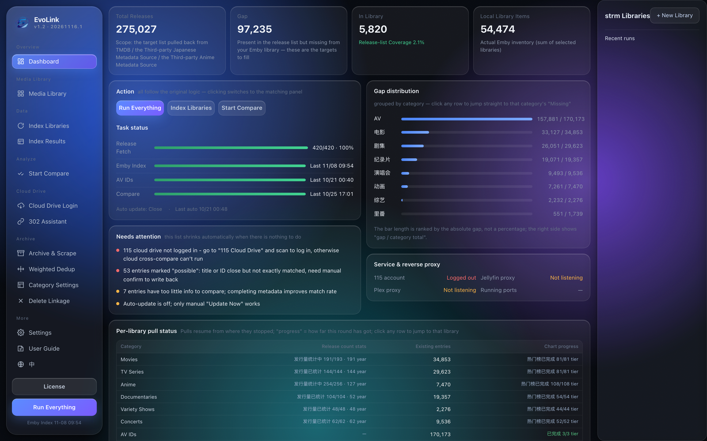
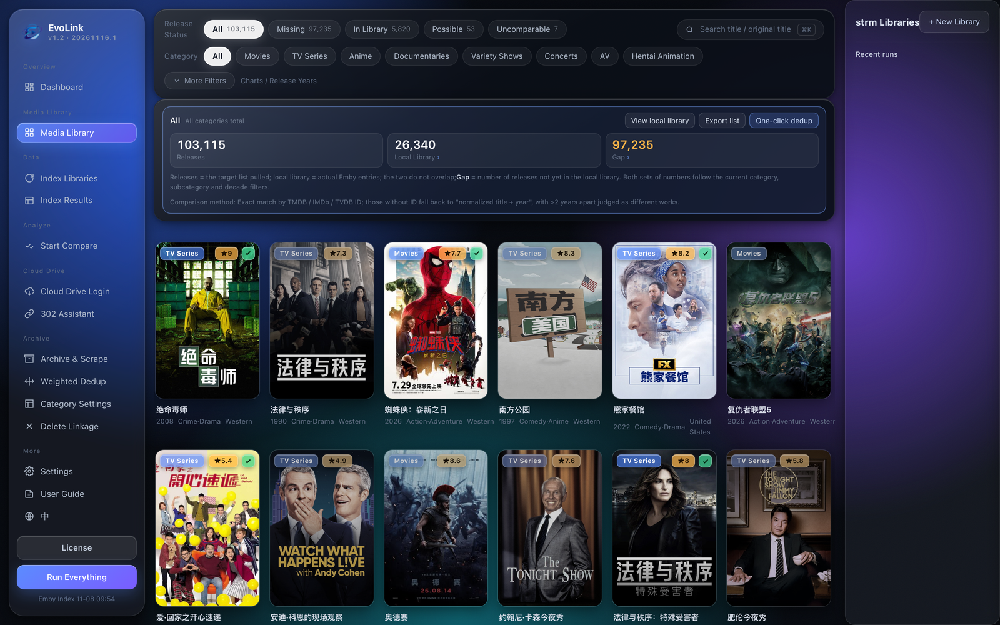
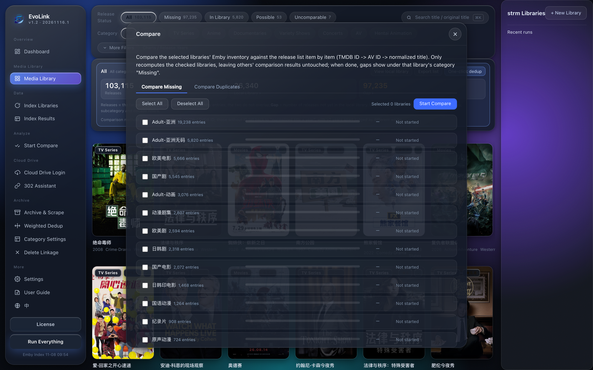

<div align="center">

# EvoLink

## Media library gap analysis · 302 link swapping · strm orchestration
### for Emby / Jellyfin / Plex / Playable

[English](README.md) · [简体中文](#中文摘要) · [国内版仓库](https://github.com/lichangzhou/EvoLink-CN)

[](LICENSE)
[](https://www.python.org/)
[](compose.yml)
[](https://github.com/lichangzhou/Evolink)
[](https://github.com/lichangzhou/Evolink)
[](https://github.com/lichangzhou/Evolink/issues)
[](https://github.com/lichangzhou/Evolink/commits/main)

</div>

---

EvoLink turns a netdisk full of media into a clean, deduplicated `.strm` library that your
media server can actually play — and, more importantly, it tells you **exactly what is
missing** from that library.

Most "media managers" scan a folder and rename files. EvoLink works one level up: it knows
what your media server already owns, what the release catalogues publish, and what the gap
between the two looks like. From that single picture it can plan the archive, clean up the
duplicates, and hand out playable links.

- **Zero third-party dependencies** — Python standard library only
- **One container** — code, pages and dependencies ship in the image
- **Four library sources** — Emby, Plex, Jellyfin and Playable are indexed side by side
- **Two builds** — the international build (this repository) and the
  [China-facing build](https://github.com/lichangzhou/EvoLink-CN), which ships the same
  engine with the adult-content providers removed

---

## Table of contents

- [Screenshots](#screenshots)
- [What it actually does](#what-it-actually-does)
- [The four building blocks](#the-four-building-blocks)
- [Gap analysis and metadata providers](#gap-analysis-and-metadata-providers)
- [Quick start](#quick-start)
- [Configuration](#configuration)
- [Architecture](#architecture)
- [Ecosystem](#ecosystem)
- [FAQ](#faq)
- [License tiers](#license-tiers)
- [Contributing](#contributing)
- [中文摘要](#中文摘要)

---

## Screenshots

**Dashboard** — inventory across all four sources, gap counters and task queue.



**Index results** — every indexed item, merged by library name and filterable by category.



**Start compare** — pick the libraries to diff against the release catalogues.



More screenshots live in [`docs/assets/`](docs/assets/).

---

## What it actually does

| Area | What you get |
|---|---|
| **Library inventory** | Index Emby, Plex, Jellyfin and Playable into one catalog; search, filter and paginate across all of them |
| **Gap analysis** | Diff what you own against TMDB / Douban / chart / catalogue sources and see what is missing, library by library |
| **302 link swapping** | `.strm` files hold a netdisk path; EvoLink signs a direct link at play time and answers with a `302` — for Emby, Jellyfin and Plex separately |
| **Archive & scrape** | Generate correctly named `.strm` files with a directory tree derived from your own classification rules — dry run first, write to disk only after you approve |
| **Weighted dedup** | Score every version of a title across 13 dimensions (resolution, codec, HDR, remux vs. web, release group…) and keep only the best one |
| **Category rules** | Define the `type → category → sub-folder` hierarchy with per-condition matching; export and import as JSON |
| **Delete linkage** | A webhook that cleans the matching `.strm` when you delete an item in Emby |
| **Cloud drive** | QR-code login for 115, directory tree, link checking and a local-scan mode that does not touch the netdisk at all |
| **Reverse proxy** | Managed `302` proxy in front of Emby / Jellyfin / Plex / Playable, including a self-signed `plex.direct` certificate |

---

## The four building blocks

### 1. 302 link swapping

A `.strm` file contains one line:

```
http://<evolink>:9191/api/swap115/115open%2FVideo%2FMovie%2Fexample.mkv
```

When the player requests it, EvoLink reads the path, signs a direct link with the
configured cookie, and replies with a `302`. The signing request and the link request must
use the same User-Agent — EvoLink handles that for you.

Three independent reverse proxies are managed from the same panel:

| Port | Upstream |
|---|---|
| `8093` | Emby |
| `8099` | Jellyfin |
| `32411` | Plex |

### 2. Library inventory

Point EvoLink at your media servers and it indexes what each one holds. Emby and Jellyfin
are read through their APIs, Plex through its own token flow, Playable through its
endpoint. Everything lands in one SQLite catalog, so a title present in Emby and Plex is
counted once when it comes to gap analysis.

### 3. Archive & scrape

Pick a source folder, an output folder and a naming template; EvoLink generates a **plan**
first. Review the plan, adjust the classification rules, then write the files. Nothing is
touched on disk until you approve it.

The directory depth is three levels:

```
Movies / Domestic / Avatar Collection / Avatar: The Way of Water (2009).strm
```

### 4. Weighted dedup

When a title exists as `4K REMUX`, `1080p WEB-DL` and `WEBRip`, each version is scored
across 13 dimensions and the highest total wins. Each dimension supports its own blacklist
and whitelist. Keep the best *N* instead of just the best one by raising "versions to keep".

Scoring profiles can be exported to and imported from JSON, so a tuned setup travels
between machines.

---

## Gap analysis and metadata providers

This is the part that makes EvoLink different from a file renamer: it compares **your
library** against **the catalogues**, not against a folder listing.

### Mainstream providers

| Provider | Used for |
|---|---|
| TMDB | Discover, trending, search, genres, certifications, posters |
| Douban | Chinese-language metadata and ratings |
| Chart / list sources | "Most wanted" release lists |

### Optional adult-content providers (international build)

The international build ships additional catalogue adapters for adult and anime-oriented
metadata, living in `app/core/sources/` and wired through `app/core/sources/lists.py`:

| Module | Covers |
|---|---|
| `javdb.py` | Japanese catalogue identifiers, release dates, charts |
| `javbus.py` | Per-studio release history and identifier lookup |
| `anilist.py` | Anime metadata and season/episode structure |
| `avres.py` | Aggregated adult-resource index and normalisation |

They add two capabilities the mainstream providers do not cover:

1. **Identifier-level matching** — a title is matched by its catalogue identifier, so
   release variants that carry different localised names still collapse into one work.
2. **Category-aware gap analysis** — the adult categories are indexed as first-class
   libraries, so "what am I missing in this category" works the same way as for mainstream
   film.

These providers are **opt-in** and require an HTTP proxy, because most of them are only
reachable from certain regions. They are disabled until you enable them in the settings
page and provide a proxy.

> The [China-facing build](https://github.com/lichangzhou/EvoLink-CN) contains none of these
> modules. If you deploy in mainland China, use that build instead — the engine is identical
> otherwise.

---

## Quick start

### 1. Clone and prepare

```bash
git clone https://github.com/lichangzhou/Evolink.git
cd Evolink
mkdir -p data
```

### 2. Adjust the two required mounts

`compose.yml` ships with sensible defaults. Edit the `volumes:` section and point these two
paths at your machine:

```yaml
volumes:
  - ./data:/app/data              # EvoLink's own config + database
  - /vol1/1000/Link:/app/Link     # your .strm library
```

Everything else is optional — comment out the line for a feature you do not use.

### 3. Run

```bash
docker compose up -d
```

Open `http://<your-nas-ip>:9191`.

> EvoLink uses `network_mode: host`, so `ports:` mappings are ignored and the service binds
> the host ports directly. Change them from the settings page, not from the compose file.

### 4. Configure

In this order:

1. **Settings** — Emby address and API key, TMDB key, 115 cookie (QR login), proxy if needed.
2. **Index Libraries** — add Emby / Plex / Jellyfin / Playable and let it index.
3. **Category Settings** — load a template, adjust the conditions, save.
4. **Archive & Scrape** — generate a plan, review it, then write.

---

## Configuration

Everything lives in `data/config.json`, which is git-ignored and created on first run.

| Key | Purpose |
|---|---|
| `emby_servers` | One or more Emby/Jellyfin instances with URL and API key |
| `plex_token` | Plex authentication token |
| `tmdb_api_key` | TMDB API key |
| `pan115_cookie` | `UID` / `CID` / `SEID` / `KID` from the QR login |
| `proxy_enabled`, `proxy_host`, `proxy_port` | Outbound HTTP proxy for metadata sources |
| `license.server` | License verification server (see below) |
| `auth_enabled`, `auth_secret` | Panel login |

### Environment variables

| Variable | Effect |
|---|---|
| `EVOLINK_HOST_IP` | The LAN IPv4 of the machine running EvoLink. Used for the self-signed `plex.direct` certificate. Auto-detected when unset. |
| `EVOLINK_LICENSE_SERVER` | Override the license verification server. Config in the settings page wins over this. |

### Ports

| Port | Purpose |
|---|---|
| `9191` | Management panel and API |
| `8093` | Emby `302` reverse proxy |
| `8099` | Jellyfin `302` reverse proxy |
| `32411` | Plex `302` reverse proxy |

> The native Emby / Jellyfin / Plex containers already own their usual ports. EvoLink must
> not occupy or modify them.

---

## Architecture

```
                    ┌──────────────────────────────────────────┐
                    │                EvoLink                   │
                    │  ┌────────────────────────────────────┐  │
   Emby ───────────▶│  │  core/sources/  metadata adapters  │  │
   Plex ───────────▶│  │  tmdb · douban · lists · (adult)   │  │
   Jellyfin ───────▶│  ├────────────────────────────────────┤  │
   Playable ───────▶│  │  core/matcher.py  normalise + score │  │
                    │  ├────────────────────────────────────┤  │
   115 ────────────▶│  │  core/pan115*.py  login + signing   │  │
                    │  ├────────────────────────────────────┤  │
                    │  │  core/strm_*.py    sync, classify,  │  │
                    │  │                    archive, weight  │  │
                    │  ├────────────────────────────────────┤  │
                    │  │  core/reverse_proxy.py  302 proxies  │  │
                    │  └────────────────────────────────────┘  │
                    │            server.py  (HTTP + tasks)      │
                    └───────────────┬──────────────────────────┘
                                    │  SQLite: data/catalog.db
                                    ▼
                         /app/Link  ←  your .strm library
```

Everything is plain Python in `app/core/`; `app/server.py` is the HTTP layer and the
background scheduler; `app/web/` holds the four single-file pages (Chinese and English,
panel and guide).

---

## Ecosystem

EvoLink is one piece of a small, self-hosted stack. The three projects are independent and
work well together on the same NAS:

| Project | What it does | How it pairs with EvoLink |
|---|---|---|
| **[Docker-Link](https://github.com/lichangzhou/Docker-link)** | Single-container Docker management panel — containers, images, volumes, networks, Compose, file manager, web terminal, remote agents | Run and monitor the EvoLink container itself; Docker-Link's Compose templates and monitoring cover the container lifecycle around it |
| **[Playable](https://github.com/lichangzhou/Playable)** | Cross-platform media player for Android, Windows and iOS | Plays the `.strm` library EvoLink maintains — including the `302` links it signs on the fly |
| **[EvoLink](https://github.com/lichangzhou/Evolink)** *(this repo)* | Media library gap analysis, archiving, deduplication and link swapping | Produces the library the other two consume |

Typical setup: **Docker-Link** keeps the stack running, **EvoLink** keeps the library
correct, **Playable** is the client.

---

## FAQ

**Link swapping returns 401 / 403.**
The 115 cookie expired, or the signing request and the playback request used different
User-Agents. Re-scan the QR code in the settings page.

**The proxy starts but the player shows nothing.**
Usually the strm directory is not mounted where EvoLink expects it, or the container cannot
read `/Link`. Check the mounts in `compose.yml`.

**The generated file names are wrong.**
Adjust the conditions under **Category Settings** first, then go to the archive page,
generate a **plan** (dry run), and only then write to disk.

**Deleting an item in Emby leaves the `.strm` behind.**
Add the Emby webhook manually, pointing at EvoLink's `/api/emby/webhook`, and save the
token on the **Delete Linkage** page.

**Scanning the whole netdisk is too slow.**
Two scan modes exist. Prefer **local mode**, which walks the CloudDrive2 mount and issues
zero netdisk requests. Use the API mode only when you really need the full remote tree.

---

## License tiers

| | Free | Pro |
|---|---|---|
| Panel, login, settings | ✅ | ✅ |
| Add media servers, index all four sources | ✅ | ✅ |
| Gap analysis, comparison, duplicates | ✅ | ✅ |
| 115 login, directory tree, read-only compare | ✅ | ✅ |
| Netdisk scan with write access | — | ✅ |
| Archive & scrape | — | ✅ |
| Weighted dedup | — | ✅ |
| Category rules and templates | — | ✅ |
| Delete linkage (webhook) | — | ✅ |
| `302` reverse proxies | — | ✅ |

Pro is a one-time purchase. Verification is enforced server-side; the panel is only a hint.
When the server cannot be reached, a previously verified Pro install keeps working for a
30-day offline grace period.

Point the verification at your own server with `EVOLINK_LICENSE_SERVER` or the
`license.server` setting.

---

## Reporting bugs and feedback

**Found a bug? Please report it here — it goes straight to the maintainer:**

| What you want to report | Where to open it |
|---|---|
| A bug or a crash | [Open a bug report](https://github.com/lichangzhou/Evolink/issues/new?template=bug_report.yml) |
| A feature request | [Open a feature request](https://github.com/lichangzhou/Evolink/issues/new?template=feature_request.yml) |
| Deployment questions / how-to | [Discussions](https://github.com/lichangzhou/Evolink/discussions) |
| A pull request | [Compare & pull request](https://github.com/lichangzhou/Evolink/compare) |

The bug template asks for the version, deployment method, host architecture and media
server you are running against — fill those in, they are what makes a report
actionable. General questions belong in Discussions rather than Issues, so bug reports
stay readable.

⚠️ **Never paste cookies, API keys, `data/config.json` or your `.strm` contents into an
issue.** Redact them first.

---

## Contributing

Issues and pull requests are welcome — see [CONTRIBUTING.md](CONTRIBUTING.md) for the
ground rules. The short version: the Chinese and English pages are mirrors and must be
updated together, runtime data never gets committed, and credentials never get pasted into
an issue.

---

## 中文摘要

**EvoLink** 是一套面向 Emby / Jellyfin / Plex / Playable 的影视库缺口比对与 `.strm` 运维工具。
它不存影片文件，只管理片名、封面、发行时间与指向网盘的 `.strm` 链接。

核心能力：

- **四源索引** —— Emby / Plex / Jellyfin / Playable 并排索引，同一作品只算一次
- **缺口比对** —— 拿你的库去和 TMDB、豆瓣、榜单以及（国际版）成人内容与动漫元数据源比对，
  逐个库列出「缺什么」
- **115 → 302 换链** —— `.strm` 里只写网盘路径，播放时才签直链 302 跳转，三套反代各自独立
- **归档刮削** —— 按分类规则生成规范命名的 `.strm`，先出计划预览，确认后才落盘
- **权重洗板** —— 同一作品多个版本按 13 个维度打分，只留最优
- **删除联动** —— Emby 里删条目，自动清理对应 `.strm`

技术上是**纯 Python 标准库**（零第三方依赖），**单个容器**即可运行。

本仓库是**国际版**，额外包含成人内容与动漫方向的元数据源适配（`app/core/sources/` 下
`javdb.py` / `javbus.py` / `anilist.py` / `avres.py`），这些源需要代理、默认关闭。

需要**不含成人内容源**的版本请用 **[EvoLink-CN](https://github.com/lichangzhou/EvoLink-CN)**，
两者引擎一致。

---

## License

[MIT](LICENSE) — 代码部分。Docker Hub 上的镜像与商业授权为另行约定。

© 2026 lichangzhou
